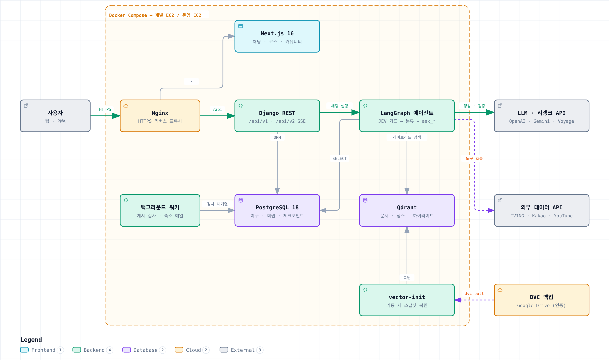

<!--
  SKN34 4차 프로젝트 README 초안 (2026-10-14 작성, develop 434443b 기준)
  - 노션 "4차 프로젝트" README 가이드 순서(팀 소개 → 개요 → 기술 스택 → WBS → 요구사항 → ERD → 주요 프로시저 → 수행결과 → 회고)에 맞춤
  - 🔴 = 가이드 필수 항목
  - [캡처 필요] / [팀원 확인] 표시는 올리기 전에 채우거나 지울 것
-->

<div align="center">

# ⚾ KBO 직관 가이드 챗봇 — 4차 고도화

**LangGraph 멀티 에이전트 · 하이브리드 RAG · 직관 코스 추천 · 재방문형 커뮤니티**

SKN34 4차 프로젝트 · 5팀 [야구는 질병이야]


</div>

---

## 목차

1. [팀 소개](#1-팀-소개) 🔴
2. [프로젝트 개요](#2-프로젝트-개요) 🔴
3. [기술 스택](#3-기술-스택) 🔴
4. [WBS](#4-wbs)
5. [요구사항 명세서](#5-요구사항-명세서)
6. [시스템 아키텍처](#6-시스템-아키텍처)
7. [LLM · RAG 파이프라인](#7-llm--rag-파이프라인)
8. [RAG 성능 개선 — 인덱싱 · 검색 · 캐싱](#8-rag-성능-개선--인덱싱--검색--캐싱)
9. [신규 기능](#9-신규-기능)
10. [화면 설계 · UX Flow](#10-화면-설계--ux-flow)
11. [ERD](#11-erd)
12. [주요 프로시저 (배치 · 관리 명령)](#12-주요-프로시저-배치--관리-명령)
13. [수행결과 — 테스트 및 시연](#13-수행결과--테스트-및-시연) 🔴
14. [트러블 슈팅](#14-트러블-슈팅)
15. [실행 방법](#15-실행-방법)
16. [디렉토리 구조](#16-디렉토리-구조)
17. [향후 개선 계획](#17-향후-개선-계획)
18. [협업 방식](#18-협업-방식)
19. [한 줄 회고](#19-한-줄-회고) 🔴

### 📦 필수 산출물

| 산출물 | 위치 |
| --- | --- |
| 요구사항 정의서 | [`docs/deliverables/`](./docs/deliverables/) · 요약은 [5. 요구사항 명세서](#5-요구사항-명세서) <!-- [팀원 확인] 파일명으로 링크 교체 --> |
| 화면설계서 | [`docs/deliverables/`](./docs/deliverables/) · 요약은 [UX Flow](#10-화면-설계--ux-flow) <!-- [팀원 확인] 파일명으로 링크 교체 --> |
| 개발된 LLM 연동 웹 애플리케이션 | 이 저장소 (`backend/` · `frontend/`) |
| 시스템 구성도 | [6. 시스템 아키텍처](#6-시스템-아키텍처) · [`docs/deliverables/02_시스템아키텍처.md`](./docs/deliverables/02_시스템아키텍처.md) |
| 테스트 계획 및 결과 보고서 | [12. 수행결과](#13-수행결과--테스트-및-시연) · [`docs/deliverables/04_테스트계획_결과보고서.md`](./docs/deliverables/04_테스트계획_결과보고서.md) |

---

## 1. 팀 소개

**팀명: 야구는 질병이야**

<table>
  <tr>
    <td align="center"><br/><b>윤성호</b><br/>LLM 구조 · 백엔드</td>
    <td align="center"><br/><b>임형준</b><br/>팀장 · LLM 인프라 보조 · QA</td>
    <td align="center"><br/><b>이현준</b><br/>인프라 · 배포 · 데이터</td>
    <td align="center"><br/><b>최인영</b><br/>코스 추천 · 프론트엔드</td>
    <td align="center"><br/><b>김진화</b><br/>커뮤니티 · DB</td>
  </tr>
  <tr>
    <td align="center"><a href="https://github.com/Seongho-haru"></a></td>
    <td align="center"><a href="https://github.com/HyeongJjun"></a></td>
    <td align="center"><a href="https://github.com/gksrkd2"></a></td>
    <td align="center"><a href="https://github.com/inyoung9629"></a></td>
    <td align="center"><a href="https://github.com/masquerade0425-hash"></a></td>
  </tr>
</table>

<!-- [팀원 확인] 아래 표는 4차 PR 기록으로 정리한 초안입니다. -->

| 이름 | 4차 담당 | 주요 작업 (PR) |
| --- | --- | --- |
| 윤성호 | LLM 구조 · 백엔드 | v1/v2 분리 · LangGraph 실행 구조(#27 · #32), JEV 가드 + capability 분류(#37 · #40), 동적 도구 할당 · 하위 에이전트(#38), API 버저닝(#22 · #23), 채팅 크레딧 · 후불 정산(#42 · #51), 답변 피드백(#45), Qdrant 이전(#63), 단계별 평가셋(#79), 평가 CI(#82), JEV 브라우저 통합(#90) |
| 임형준 | 팀장 · LLM 인프라 보조 · QA | 피드백 분석 · 우선순위, 규정집 청킹(#24), 일정 · 순위 DB 분리(#30), 하이라이트 영상(#67 · #86), 하이브리드 검색 + 리랭크(#78), chat_eval 실대화 평가(#81), QA 수정 사이클(#84 ~ #95), v1 → v2 이전, PR 리뷰 · 머지, README · 산출물 |
| 이현준 | 인프라 · 배포 · 데이터 | 개발/운영 서버 분리 · CI/CD 배포 게이트, 크롤링 v3 증분 upsert(#29), 환상게임 + 포인트(#66), 회원 등급제(#98), PWA(#99) |
| 최인영 | 코스 추천 · 프론트엔드 | 경기 기준 코스 추천 · 장소 RAG(#49), 구장 안/밖 구분 · 식당 교체 · 술집 평점 게이트(#92), 코스 메뉴 · 후기 근거(#96), 화면 |
| 김진화 | 커뮤니티 · DB | 커뮤니티 게시 검사 · 워커 · 관리자 화면(#91), 자동/수동 검사 전환(#97), 회원가입 응원팀 선택(#34) |

---

## 2. 프로젝트 개요

### 2.1 프로젝트명

**KBO 직관 가이드 챗봇 (4차 고도화)** — LLM을 연동한 내외부 문서 기반 질의응답 웹 서비스

### 2.2 프로젝트 소개

> 야구장에 처음 가는 팬도 **"잠실 경기 전에 뭐 먹고, 주차는 어디에, 뭘 가져가면 안 돼?"** 를 한 번에 물어보고,
> **경기 전 식사 → 경기 관람 → 경기 후 갈 곳** 코스를 지도로 받아보는 KBO 직관 안내 챗봇입니다.
>
> 4차에서는 3차 서비스를 바탕으로 **LLM 구조를 처음부터 다시 짜고**(LangGraph 멀티 에이전트), **검색을 하이브리드로 바꾸고**, **데이터를 자동으로 갱신**하며, 한 번 쓰고 끝나지 않도록 **하이라이트 · 등급 · 환상게임 · 게시 검사** 같은 재방문 기능을 더했습니다.

### 2.3 프로젝트 필요성 (배경)

**① 시장 — 1,200만 관중 시대, 새로 온 팬은 "야구장 초보"**

| 지표 | 수치 | 출처 |
| --- | --- | --- |
| 2025 시즌 총 관중 | **1,231만 2,519명** (역대 최다) | [머니투데이, 2026.09.13][mt] |
| 2026 시즌 1,100만 돌파 | **626경기 만** (2025년보다 17경기 빠름) | [중부뉴스통신, 2026.09.13][jb] |
| 온라인 예매자 중 여성 비율 | **57.5%**, 20대 예매자 중 여성 **63.6%** | [한국경제, 2025.09.05][hk] |
| 야구 정보를 모바일로 찾는 비율 | **84.3%** | [2025 KBO 팬 성향 조사][fan] |
| 원정 팬 경기 전 간식 · 식사 / 지역 맛집 방문 | **76% / 60%** | [이투데이, 2025.10.06][et] |

구장 정보(반입 · 주차 · 좌석 · 재입장)는 10개 구단 홈페이지에 제각각 흩어져 있고, 맛집 · 일정은 또 다른 앱에서 찾아야 합니다. 일반 LLM은 날짜 · 순위 · 가격을 지어냅니다.

**② 3차 평가 피드백 — 4차에서 풀어야 할 문제**

| 3차 피드백 (강사 · 선도기업) | 4차 과제 |
| --- | --- |
| 매일 단위 자동 수집 · 정기 갱신 체계가 없음 | 데이터 최신화 파이프라인 |
| 도구 28개 — 사용 빈도 · 성공률 기준 정리, 라우팅 정확도 검증 필요 | 도구 선택 안정성 |
| 개인화된 직관 코스 | 코스 추천 고도화 |
| 단발성 서비스 → 등급 · 포인트 · 재방문 유도, 모바일 확장 | 재방문 기능 · PWA |
| 신고 · 게시물 관리는 AI가 1차 분류, 최종 조치는 관리자 | 커뮤니티 게시 검사 |
| 테스트 보고서 — 정확성 · 관련성 평가 기준 제시 | 평가 체계 재설계 |

### 2.4 프로젝트 목표

| # | 목표 | 측정 기준 |
| --- | --- | --- |
| 1 | **데이터 최신화** — 매번 전체 재색인하던 구조를 바뀐 행만 갱신하는 구조로 | 증분 upsert, 일정 · 순위는 DB 직접 조회 |
| 2 | **도구 선택 안정성** — 정규식 라우팅 + 도구 28개 일괄 노출을 LLM 분류 + 필요한 도구만 노출로 | 단계별 평가셋 160건, 가드 오판률 |
| 3 | **검색 정확도** — 규정집 전체를 넣고 조항 · 고유명사까지 정확히 찾기 | 규정 31문항 Hit@1 · MRR |
| 4 | **개인화 코스** — 경기 시각 · 동행 · 메뉴 조건을 반영하고 구장 안/밖을 구분 | 코스 평가 · 실대화 평가 |
| 5 | **재방문 구조** — 하이라이트 영상, 등급 · 포인트, 환상게임, 응원팀, PWA | 기능 구현 · 시연 |
| 6 | **AI 1차 분류 + 관리자 최종 조치** — 커뮤니티 게시 검사 | 자동 검사 → 운영진 확정 흐름 |
| 7 | **평가 기준 제시** — 실대화 시나리오를 같은 문항으로 전후 비교하고, 회귀 평가를 배포 게이트로 | chat_eval 59문항 × 2회, CI 필수 통과 |

### 2.5 3차 → 4차 한눈에 보기

| 구분 | 3차 | 4차 |
| --- | --- | --- |
| 질문 라우팅 | 정규식 dispatcher | **JEV 가드 + capability 분류(LLM)** → 동적 도구 할당 |
| 에이전트 | 단일 assistant 도구 루프, 도구 28개 공유 | **메인 에이전트 + 전문 하위 에이전트 6개** (`ask_baseball` · `ask_course` · `ask_place_data` · `ask_travel_research` · `ask_web_research` · `ask_highlight`) |
| 실행 구조 | LangChain 체인 (v1) | **LangGraph (v2)**, Postgres 체크포인터, v2 런타임의 v1 import 0건 |
| 벡터 DB | pgvector + 키워드 재정렬 | **Qdrant + 하이브리드(BM25 + 벡터, RRF) + voyage rerank** |
| 규정 데이터 | 기초규칙 요약 11청크 | **공식야구규칙 · KBO리그규정 398청크** (조 · 항 단위) |
| 일정 · 순위 | 벡터 청크 + DB 이중 보관 | **DB 도구로만 조회** (벡터 사본 792청크 제거) |
| 데이터 갱신 | 수동, 매번 전체 재색인 | **크롤링 v3 증분 upsert**(doc_id + content_hash), EC2 cron |
| 평가 | 골든셋 85문항 (정답률 · Hit@5) | **실대화 59문항** + **단계별 평가셋 160건** + **eval_retrieval** + **CI 회귀 평가** |
| 서버 | EC2 1대 | **개발 / 운영 EC2 분리**, 평가 통과해야 배포 |
| 사용량 | 회원만 질문 가능 | 비회원 체험 + **실사용 후불 정산** |
| 신규 기능 | — | 하이라이트 영상, 코스 메뉴 · 후기, 게시 검사, 등급제, 환상게임, PWA, 응원팀, 답변 피드백 |

---

## 3. 기술 스택

<table>
  <tr><th>구분</th><th>기술</th></tr>
  <tr><td align="center"><b>Frontend</b></td><td>     </td></tr>
  <tr><td align="center"><b>Backend</b></td><td>     </td></tr>
  <tr><td align="center"><b>LLM · Agent</b></td><td>      </td></tr>
  <tr><td align="center"><b>RAG · Search</b></td><td>    </td></tr>
  <tr><td align="center"><b>Evaluation</b></td><td>   </td></tr>
  <tr><td align="center"><b>Database</b></td><td>  </td></tr>
  <tr><td align="center"><b>Infra</b></td><td>    </td></tr>
  <tr><td align="center"><b>External API</b></td><td>     </td></tr>
  <tr><td align="center"><b>협업</b></td><td>    </td></tr>
</table>

---

## 4. WBS

**2026.09.21 ~ 2026.10.15** (약 3.5주) <!-- [팀원 확인] 시작일 -->

| 기간 | 단계 | 주요 작업 |
| --- | --- | --- |
| 09.21 ~ 09.23 | 분석 · 계획 | 3차 피드백 분석, 우선순위(P0 ~ P3), 3차 기준선 측정, API 버저닝(`/api/v1` · `/api/v2`) |
| 09.24 ~ 10.03 | LLM 구조 재설계 | LangGraph v2, JEV 가드 + capability 분류, 하위 에이전트, 규정집 398청크, 크롤링 v3 · 일정 · 순위 DB 분리, 크레딧 → 후불 정산, 모델 통일 |
| 10.06 ~ 10.09 | 검색 · 신규 기능 | pgvector → Qdrant 이전, 하이라이트 영상, 경기 기준 코스 추천, 환상게임 + 포인트 |
| 10.10 ~ 10.13 | 평가 · QA 사이클 | 하이브리드 검색 + 리랭크, 단계별 평가셋, chat_eval, 평가 CI, QA 수정 PR 7건(#84 ~ #90 · #95), 게시 검사, 코스 안정화 · 메뉴 · 후기, v1 → v2 이전 |
| 10.14 | 마무리 · 배포 검증 | 회원 등급제, PWA, 개발 서버 색인 · 실측, 산출물 · 발표 |
| 10.15 | 발표 · 시연 | |

---

## 5. 요구사항 명세서

> 📄 요구사항 정의서: [`docs/deliverables/`](./docs/deliverables/) <!-- [팀원 확인] 4차 요구사항 정의서 · 화면설계서 파일명으로 링크 교체 -->
> 3차 요구사항(FR-01 ~ FR-20 · NFR-01 ~ NFR-10)은 유지하고, 4차에서 추가 · 변경한 항목만 적었습니다. 상태: ✅ 구현 · 🟡 일부

### 5.1 기능 요구사항 (4차 추가 · 변경)

| ID | 구분 | 요구사항 | 구현 내용 | 상태 |
| --- | --- | --- | --- | :---: |
| FR-21 | 챗봇 | 범위 밖 질문을 LLM 판단으로 차단 | JEV 가드(OpenRouter) — 편의시설 · 링크 요약은 통과, 코딩 · 레시피 · 코인 등은 차단 | ✅ |
| FR-22 | 챗봇 | 질문 유형에 맞는 도구만 사용 | capability 분류 → 동적 도구 할당, 전문 하위 에이전트 위임 | ✅ |
| FR-23 | 챗봇 | 의도가 모호하면 되묻기 | 도구 0개로 텍스트 되묻기, 직관 계획 구조화 질문(`present_planning_questions`) | ✅ |
| FR-24 | 챗봇 | 공식 야구규칙 · KBO 리그 규정 질의 | 398청크 하이브리드 검색 + 리랭크 | ✅ |
| FR-25 | 챗봇 | 하이라이트 장면 검색 · 재생 | "김도영 홈런 영상" → 영상 카드, 장면 시각부터 재생 (공식 임베드만) | ✅ |
| FR-26 | 챗봇 | 숙소 · 웹 정보 조사 | JEV 브라우저(MCP)로 원문 수집, 웹 검증 기본 off | ✅ |
| FR-27 | 챗봇 | 비회원 체험 · 사용량 관리 | 비회원 50만 토큰, 회원 월 한도, 실사용 후불 정산, 동시 요청 409 | ✅ |
| FR-28 | 챗봇 | 답변 피드백 | 좋아요 / 아쉬워요 + 사유, 관리자 피드백 화면 | ✅ |
| FR-29 | 코스 | 경기 기준 개인화 코스 | 경기 시각 · 동행 조건, 구장 안/밖 구분, 메뉴 동의어 · 후기 근거, 외부 술집 평점 게이트 | ✅ |
| FR-30 | 커뮤니티 | 게시 전 자동 검사 + 관리자 확정 | OpenAI 자동 검사 / 수동 선택, 이미지 글은 운영진 확인, 삭제 없이 공개 여부만 변경 | ✅ |
| FR-31 | 회원 | 포인트 · 등급 | 포인트 원장, 5단계 등급(1,000 / 2,500 / 5,000 / 7,500), 가입 보상 100P(등급 점수 제외) | ✅ |
| FR-32 | 회원 | 응원팀 | 회원가입 시 응원팀 선택(`team_code`) | ✅ |
| FR-33 | 재방문 | 환상게임 | 주간 타자 1 · 투수 1 선택 → 기록 × 배율 점수 → 포인트 정산 | ✅ |
| FR-34 | 모바일 | 설치형 웹앱 | PWA manifest | ✅ (1단계) |
| FR-35 | 데이터 | 자동 갱신 | 크롤링 v3 증분 upsert, EC2 cron | ✅ |
| FR-36 | 데이터 | 마지막 갱신 시각 표시 | 답변 · 화면에 기준 시각 노출 | 🟡 향후 |

### 5.2 비기능 요구사항 (4차 추가 · 변경)

| ID | 구분 | 요구사항 | 구현 · 검증 | 상태 |
| --- | --- | --- | --- | :---: |
| NFR-11 | 정확성 | 실대화 시나리오 기준 품질 | chat_eval 59문항 **58/59 × 2회** (남은 1건은 OpenAI 시간 초과, 제품 실패 0) | ✅ |
| NFR-12 | 검색 | 규정 검색 정확도 | Hit@1 0.710 → **0.903**, MRR 0.811 → **0.952** | ✅ |
| NFR-13 | 품질 게이트 | 회귀가 있으면 배포 안 함 | `evaluation-regression` CI 필수 통과 | ✅ |
| NFR-14 | 운영 | 개발 / 운영 분리 | develop → 개발 EC2, main → 운영 EC2 자동 배포 | ✅ |
| NFR-15 | 비용 | 사용량 상한 | 토큰 실사용 정산, 하이라이트 수집 예산 상한 | ✅ |
| NFR-16 | 저작권 | 영상 다운로드 금지 | YouTube 공식 임베드만, 영상 구간 임베딩 방식 제외 | ✅ |

---

## 6. 시스템 아키텍처

> 📄 시스템 구성도: [`docs/deliverables/02_시스템아키텍처.md`](./docs/deliverables/02_시스템아키텍처.md) <!-- [팀원 확인] 4차 구성도 이미지로 교체 -->

<!-- [캡처 필요] 4차 시스템 구성도 이미지 (Qdrant · 하위 에이전트 · 워커 · 개발/운영 EC2 포함) -->
<p align="center"></p>

| 계층 | 구성 | 역할 |
| --- | --- | --- |
| Client | Next.js 16 · React 19 · Kakao Map SDK · PWA | 채팅, 코스 · 지도, 일정 · 순위 · 하이라이트, 커뮤니티, 환상게임, 마이페이지 |
| Gateway | Nginx (HTTPS) | `/` → frontend, `/api/` → backend, 채팅 스트리밍 read timeout 360s |
| API | Django 6.1 · DRF · SimpleJWT · gunicorn | `/api/v1`(회원 · 야구 · 코스 · 커뮤니티 · 환상게임), `/api/v2/chat`(채팅 SSE) |
| LLM | LangGraph · OpenAI(gpt-6-luna) · OpenRouter | JEV 가드 → capability 분류 → 메인 에이전트 → 하위 에이전트 → 스트리밍 |
| Vector DB | Qdrant | 문서 컬렉션(dense + sparse), 장소 RAG, 하이라이트 장면(`kbo_highlight_scenes`) |
| RDB | PostgreSQL 18 | 야구 28개 모델 · 회원 · 채팅 · 체크포인트 · 코스 · 커뮤니티 · 환상게임. 챗봇은 읽기 전용 계정 |
| Worker | `community-moderation-worker`, `lodging-warmer`, `course-place-warmer`, `jev-browser` | 게시 검사, 숙소 · 코스 장소 캐시 예열, 웹 원문 수집 |
| Storage · Mail | MinIO · SMTP(운영) / Mailpit(개발) | 커뮤니티 이미지, 인증 메일 |
| Ops | GitHub Actions · Discord · LangSmith · EC2 cron | 빌드 · 평가 게이트 · 배포, 알림, 추적, 정기 수집 |

### 6.1 개발 / 운영 서버

| 구분 | 배포 브랜치 | 워크플로 | 실행 방식 |
| --- | --- | --- | --- |
| 개발 | `develop` push 시 자동 | `deploy-dev.yml` | `runserver` · `next dev`, Mailpit |
| 운영 | `main` push 시 자동 | `deploy-prod.yml` | gunicorn 2 workers × 4 threads · `next start`, SMTP 실발송, `DEBUG=false` |

- **배포 게이트**: `manage.py check` + `next build` + **`evaluation-regression`(LLM 평가 회귀)** 중 하나라도 실패하면 배포 중단, Discord 알림
- **배포 방식**: GitHub Actions에서 이미지 빌드 → scp → EC2에서 `docker load` → `up --no-build` → `migrate` · `setup_chat_checkpoints`
- **평가 워크플로**: `evaluation-regression`(무료 회귀, 필수) · `evaluation-pr-ab`(PR 전후 비교) · `evaluation-manual` · `evaluation-quality-review`(유료, 수동)

---

## 7. LLM · RAG 파이프라인

### 7.1 전체 흐름

<!-- [캡처 필요] 4차 채팅 파이프라인 그림 -->

```
질문
 → JEV 가드 (범위 판단, OpenRouter) ── 무관 질문 → 고정 안내 (메인 LLM 호출 0회)
 → capability 분류 (14개 중 선택)
 → 동적 도구 할당 (해당 capability 도구만 노출)
 → 메인 에이전트 (LangGraph, 호출 예산 제한)
      ├─ 직접 도구: 일정 · 순위 · 구장 · 문서 검색 · 날씨 · 길찾기 …
      └─ 하위 에이전트 위임: ask_baseball · ask_course · ask_place_data
                            ask_travel_research · ask_web_research · ask_highlight
 → 최종 답변 토큰 스트리밍 (SSE: progress … → delta … → done(코스 · 영상 카드))
 → 사용량 정산 · 체크포인트 저장(Postgres)
```

| 단계 | 3차 | 4차 |
| --- | --- | --- |
| 범위 판단 | 정규식 단어 목록 (`HARD_OFF`) | LLM 가드 + 기준 문서(`GUARD_CRITERIA`) — 편의시설 · 링크 요약처럼 단어로는 못 가르던 경우를 판단 |
| 도구 선택 | 도구 28개 전부 노출 | capability별로 필요한 도구만 → 잘못된 도구 호출 감소 |
| 복잡한 작업 | 메인이 직접 처리 | 코스 · 장소 · 웹 · 하이라이트는 전문 하위 에이전트가 처리하고 결과만 반환 |
| 상태 | 세션 테이블 | LangGraph 체크포인터(Postgres), 대화 이어 받기 |

### 7.2 하위 에이전트

| 에이전트 | 맡는 질문 | 주요 도구 |
| --- | --- | --- |
| `ask_baseball` | 일정 · 순위 · 선수 · 티켓 · 규정 | 고정 SQL 도구, 제한된 `SELECT`, 규정 검색 |
| `ask_course` | 직관 코스 생성 · 수정 | `plan_course`, 길찾기, 장소 RAG — LLM은 장소 키 · 이유만 고르고 이름 · 좌표 · 거리는 DB · 코드 값 (좌표 환각 0) |
| `ask_place_data` | 구장 주변 식당 · 카페 · 메뉴 · 후기 | 장소 RAG(`search_place_knowledge`), 메뉴 동의어 |
| `ask_travel_research` | 숙소 · 관광 | JEV 브라우저 원문, TourAPI |
| `ask_web_research` | 내부 데이터에 없는 최신 정보 · 링크 요약 | JEV 브라우저 (기본 off, 허용 범위 제한) |
| `ask_highlight` | 하이라이트 장면 | 조건 검색(선수 · 이닝 · 결과) + 묘사 검색("슈퍼캐치") → 서버가 영상 카드 생성 |

### 7.3 안전장치 (3차에서 유지 · 강화)

- **DB 조회**: 읽기 전용 계정, sqlglot으로 SELECT 1문장만 허용, 최대 200행 · 3초 · 락 대기 1초
- **근거 등급**: OFFICIAL / UNCERTAIN / UNOFFICIAL / THIRD_PARTY별 말투, 확정 안 된 행은 인덱싱 단계에서 본문에도 문구 삽입
- **내부 용어 숨김**: SQL · 테이블명 · 도구 이름은 답변에 쓰지 않음, 진행 기록 상세는 관리자만
- **사용량**: 요청 단위 실사용 토큰 정산, 같은 사용자 동시 요청은 409

---

## 8. RAG 성능 개선 — 인덱싱 · 검색 · 캐싱

> 4차 가이드의 원칙대로 **문제 확인 → 전략 선택 → 적용 → 성능 비교** 순서로 진행했습니다.

### 8.1 가이드 최종 체크 대응

| 가이드 체크 | 우리 상황 (문제 확인) | 선택한 전략 · 결과 |
| --- | --- | --- |
| 질문할 때 전체 문서를 다시 인덱싱하는가? | 아니오 | 인덱싱은 관리 명령(`build_index` · `build_sparse_index` · `index_highlights`), 요청 때는 검색 + 생성만 |
| 일부 변경 때문에 전체를 재인덱싱하는가? | **3차는 예** (delete → bulk_create 전체 교체) | **증분 인덱싱** — `doc_id` + `content_hash`로 바뀐 행만 upsert (크롤링 v3) |
| 문서 처리 시간이 너무 긴가? | 사용자 문서 업로드 기능은 없음. 다만 게시 검사 · 하이라이트 분석 · 숙소 수집은 수 초 ~ 수 분 | **비동기 처리** — Celery 대신 DB 대기열 + 전용 워커(임대 · 재시도 횟수 제한), 숙소 · 장소 예열 워커, EC2 cron 수집. 사용자에게는 먼저 응답 |
| 처리 상태를 관리하는가? | 게시 글이 검사 중인지 알 수 없으면 혼란 | **상태 관리** — 게시 검사 `검사 대기 → 승인 / 운영진 검토 → 보류 확정`, 하이라이트 영상 `ANALYZED` 상태, 회원 화면 "내 게시 검사 상태" |
| 동일 질문이 자주 반복되는가? | 순위 · 일정 · 날씨처럼 **실시간 값이 대부분** | Answer Cache는 **적용하지 않음** — 캐시하면 오래된 순위를 답할 위험이 더 큼. 대신 DB 직접 조회로 정확도 우선 ([17장](#17-향후-개선-계획)에 코퍼스 버전 키 캐시 계획) |
| 검색 범위를 줄일 필요가 있는가? | 구장 · 카테고리가 명확 | **Metadata Filter** (구장 코드 · 카테고리 · 근거 등급) |
| 사용자마다 볼 수 있는 문서가 다른가? | 공개 데이터라 해당 없음 | 권한은 기능 단위로 — 진행 기록 상세 · 게시 검사 화면은 관리자만, 비회원 / 회원 사용량 분리 |
| 필요한 문서는 나오는데 순위가 낮은가? | **예** — 규정 Hit@1 0.710 | **Hybrid Search + Reranking** → Hit@1 **0.903** (아래 8.3) |
| 코드가 View에 몰려 있는가? | 아니오 | `llm/service`(채팅 · 정산 · 피드백) / `llm/v2`(에이전트 · 미들웨어) / 앱별 도구로 계층 분리 |
| top-k는 적절한가? | 많이 넣을수록 입력 토큰 · 시간 증가 | 후보는 넓게(벡터 50 + BM25 50 → 30), LLM에는 **리랭크 상위 5개만** |
| Retrieval과 LLM 중 어디가 느린가? | **LLM이 응답 시간의 99% 이상** — 3차 실측 Retrieval 9 ms · LLM 2,643 ms · Total 2,661 ms (중앙값) | 검색이 아니라 도구 계획 · 생성을 줄임 — 하위 에이전트 분리, 불필요한 도구 호출 제거(되묻기는 도구 0개). 리랭크 추가로 검색은 약 0.66초로 늘었지만 전체 대비 작아 정확도를 택함 |
| 생성이 느리면? | 답변 생성 대기 동안 빈 화면 | **Streaming** — SSE로 토큰 단위 전송 + 도구 진행 표시("순위 조회 중 → 완료"). 체감 속도 개선 |

### 8.2 데이터 계층 정리

| 데이터 | 3차 | 4차 |
| --- | --- | --- |
| 일정 · 순위 · 결과 | 벡터 청크 + DB 이중 보관 → 답이 달라질 수 있음 | **DB만 정본**, 벡터 사본 792청크 제거 |
| 공식 규칙 · 리그 규정 | 기초규칙 요약 11청크 | 조 · 항 단위 **398청크** (1,400자, 상위 조항 헤더 반복) |
| 구장 · 장소 문서 | pgvector 테이블 | **Qdrant** 이전 (3,447건 재임베딩 없이 이전, PG 테이블은 롤백용 유지) |
| 하이라이트 | — | 영상 장면표 → Qdrant `kbo_highlight_scenes` (로컬 기준 영상 33개 · 장면 1,397개) |

### 8.3 하이브리드 검색 + 리랭크

**구조**: 벡터 50 + BM25 50 → 가중 RRF(k=60) 후보 30 → voyage rerank-2.5 상위 5 (리랭커 실패 시 RRF 순서로 대체)

**규정 31문항 (golden_rule)**

| 방식 | Hit@1 | Hit@5 | MRR | P50 |
| --- | ---: | ---: | ---: | ---: |
| vector (기존) | 0.710 | 0.968 | 0.811 | 18 ms |
| hybrid RRF만 | 0.613 | 0.903 | 0.740 | 23 ms |
| rerank cohere | 0.871 | 1.000 | 0.935 | 669 ms |
| **rerank voyage (채택)** | **0.903** | **1.000** | **0.952** | 661 ms |

- 구장 23문항(문서 경로): Hit@5 0.870 → 0.913, MRR 0.815 → 0.857 (회귀 없음 확인)
- **교훈**: RRF만 붙이면 오히려 떨어짐 → BM25는 후보를 넓히는 역할, 순서는 리랭커가 결정. 리랭크로 늘어난 약 0.6초는 전체 응답 시간(LLM이 대부분) 대비 작아서 채택

---

## 9. 신규 기능

| 기능 | 내용 |
| --- | --- |
| 🎬 **하이라이트 영상** | KBO 공식 YouTube 재생목록 → Gemini로 장면표(시각 · 이닝 · 타자 · 결과 · 타점 · 설명) 생성 → Qdrant 색인. "김도영 최근 홈런" → 영상 카드, 해당 장면부터 재생. 가을야구(와일드카드 ~ 한국시리즈) 제목 인식. 다운로드 없이 공식 임베드만 |
| 🗺️ **개인화 코스** | 경기 시각 기준 도착 시간 조정, 구장 안/밖 방문 구분(`visit_roles`), 메뉴 동의어(돈카츠/돈가스), 공개 페이지 메뉴 · 후기 인용 대조, 외부 술집 평점 게이트 |
| 🛡️ **커뮤니티 게시 검사** | 글 · 댓글을 공개 전에 검사 → 문제없으면 수 초 안에 공개, 유해 판정이면 비공개 + 운영진 확인. 관리자가 자동(OpenAI omni-moderation) / 수동 선택, 이미지 글은 항상 운영진 확인, 삭제 없이 공개 여부만 변경 |
| 🏅 **포인트 · 등급제** | 포인트 원장(멱등 지급), 5단계 등급(1,000 / 2,500 / 5,000 / 7,500점), 가입 보상 100P는 잔액에만, 게시판 작성자 등급 표시 |
| ⚾ **환상게임** | 매주 다음 주 타자 1 · 투수 1 선택 → 월요일 배율(1 ~ 9) 확정 → 관리자 기록 입력 → 결산 시 점수 × 지급률로 포인트. 결산 전 기록 · 선택 검증, 취소 시 포인트 · 등급 점수 회수 |
| 💬 **답변 피드백** | 좋아요 / 아쉬워요 + 사유, 관리자 피드백 화면 |
| 📣 **응원팀** | 회원가입 시 응원팀 선택 |
| 📱 **PWA** | 홈 화면에 설치하는 웹앱 |
| 🎟️ **비회원 체험 · 정산** | 비회원도 일정 토큰까지 질문 가능, 회원 월 한도, 실사용 후불 정산 |

---

## 10. 화면 설계 · UX Flow

> 📄 화면설계서: [`docs/deliverables/`](./docs/deliverables/) <!-- [팀원 확인] 화면설계서 파일 링크 -->

<!-- [캡처 필요] 4차 화면 흐름도 (와이어프레임 또는 화면 흐름 이미지) -->
<p align="center"></p>

```
메인(/) ─┬─ 챗봇(/chat) ── 코스 답변 → 지도 카드 → 코스 저장(/routes/new)
         │                └─ 하이라이트 답변 → 영상 카드 → 하이라이트(/highlights)
         ├─ 직관 코스(/routes · /routes/[id] · /routes/new)
         ├─ 일정 · 순위(/schedule · /standings · 팀 · 선수 상세)
         ├─ 구장(/stadiums · /stadiums/[code]) · 야구 가이드(/guide)
         ├─ 커뮤니티(/community · /community/write → 게시 검사 상태 /community/submissions)
         │            └─ 승부 예측(/community/predictions)
         ├─ 환상게임(/fantasy)
         └─ 마이페이지(/mypage: 등급 · 포인트 · 응원팀 · 내 글 · 내 코스)
관리자(/admin) ─ 게시 검사 · 신고 · 야구 데이터(/admin/baseball) · 답변 피드백(/admin/feedback) · 환상게임 기록(/fantasy/admin)
```

| 화면 | 4차 변경 | 캡처 |
| --- | --- | --- |
| 챗봇 (`/chat`) | 비회원 체험, 하위 에이전트 진행 표시, 영상 카드, 답변 피드백, 되묻기 질문 UI | [캡처 필요] |
| 직관 코스 (`/routes/new`) | 경기 기준 코스, 구장 안/밖 구분, 메뉴 · 후기 근거 | [캡처 필요] |
| 하이라이트 (`/highlights`) | 장면 시각부터 재생 | [캡처 필요] |
| 커뮤니티 (`/community/write` → `/community/submissions`) | 게시 검사 상태, 작성자 등급 표시 | [캡처 필요] |
| 환상게임 (`/fantasy`) | 주간 타자 · 투수 선택, 결과 · 포인트 | [캡처 필요] |
| 마이페이지 (`/mypage`) | 등급 · 포인트 · 응원팀 | [캡처 필요] |
| 관리자 (`/admin`) | 게시 검사 탭(자동 / 수동, 해제 · 확정), 답변 피드백 | [캡처 필요] |

---

## 11. ERD

<!-- [캡처 필요] 4차 ERD 이미지 (3차 erd.svg는 신규 테이블 없음) -->
<p align="center"></p>

| 앱 | 주요 모델 | 4차 변경 |
| --- | --- | --- |
| `baseball` | Team · Stadium · Game · StandingHistory · Player · PlayerSeasonRecord · TicketPrice · TicketPolicy · SeatZone · FoodStore · FoodStoreMenu 등 28개 | 포스트시즌 단계(`PostseasonStage`), 선수 기록 · 로스터 |
| `llm` | Document · DocumentChunk · ChatSession · ChatAttachment · **AnswerFeedback · UsageWallet · UsageCharge · GuestChatUsage · HighlightVideo · HighlightScene** | 피드백, 사용량 정산, 하이라이트 |
| `accounts` | CustomUser · EmailChangeChallenge · **PointWallet · PointTransaction** | 응원팀(`team_code`), 포인트 · 등급 |
| `community` | CommunityPost · CommunityComment · CommunityImage · CommunityReport · PredictionGame · GamePrediction · **ModeratedContent** | 게시 검사 |
| `fantasy` | **FantasyWeek · FantasySelection · FantasyBattingGameStat · FantasyPitchingGameStat · FantasySettlement · FantasyUserResult · FantasyPlayerScore** | 신규 앱 |
| `travel` | Course · CourseStop · Place · CourseReaction · CourseView · ExternalProviderSnapshot | 코스 작성자(`Course.owner`) |
| `ads` | AdPlacement · AdCreative · AdEvent | 광고 슬롯 (향후 수익화용) |

---

## 12. 주요 프로시저 (배치 · 관리 명령)

| 분류 | 명령 / 스크립트 | 하는 일 | 실행 |
| --- | --- | --- | --- |
| 색인 | `build_index` | 문서 → 청크 → 임베딩 → Qdrant (doc_id + content_hash) | 최초 · 데이터 변경 시 |
| 색인 | `build_sparse_index` | BM25 sparse 색인 | `build_index` 후 |
| 색인 | `build_place_rag` | 구장 주변 장소 RAG | 장소 데이터 변경 시 |
| 수집 | `crawling/run_crawlers.sh` | TVING 일정 · 순위 · 선수 → DB upsert, 티켓 정책 → 벡터 증분 | EC2 cron |
| 하이라이트 | `collect_highlights` → `index_highlights` | YouTube 목록 → Gemini 장면 분석(예산 상한) → Qdrant | `crawling/run_highlights.sh` cron |
| 커뮤니티 | `run_moderation_worker` | 대기 글 게시 검사 (몇 초 간격, 임대 · 재시도) | 워커 컨테이너 상시 |
| 환상게임 | `confirm_fantasy_selections` → `finalize_fantasy_week_stats --confirm-loaded` → `settle_fantasy_week` | 배율 확정 → 기록 확정 → 포인트 정산 | 월 / 관리자 / 화 (`fantasy-jobs.sh`) |
| 캐시 예열 | `warm_lodging_cache` · `warm_course_places` | 숙소 · 코스 장소 미리 수집 | 워커 컨테이너 |
| 평가 | `chat_eval` · `eval_retrieval` · `evaluate_courses` · `export_ragas` | 실대화 · 검색 · 코스 평가 | 수동 · CI |
| DB | `provision_baseball_reader` | 챗봇 읽기 전용 계정 권한 준비 | 컨테이너 시작 시 |
| 체크포인트 | `setup_chat_checkpoints` | LangGraph 체크포인트 테이블 | 배포 시 |

---

## 13. 수행결과 — 테스트 및 시연

> 📄 테스트 계획 및 결과 보고서: [`docs/deliverables/04_테스트계획_결과보고서.md`](./docs/deliverables/04_테스트계획_결과보고서.md) <!-- [팀원 확인] 4차 보고서로 교체 -->

### 13.1 테스트 계획

| 구분 | 대상 | 방법 | 지표 |
| --- | --- | --- | --- |
| 실대화 평가 | 실제 챗봇 API 전체 | `chat_eval` 59문항, 같은 문항으로 수정 전후 2회씩 | 통과 수, 문항별 시간 · 토큰 · 도구 |
| 단계별 평가 | 가드 → capability → 도구 할당 → 첫 행동 → 되묻기 → 위임 → 오류 대응 → 최종 답변 | 평가셋 160건, **중대 실패 5종**(한 건이면 불합격) | 단계별 정확도 |
| 검색 평가 | 규정 · 구장 문서 검색 | `eval_retrieval` | Hit@1 · Hit@5 · MRR · P50 |
| 가드 반복 측정 | JEV 가드 | 같은 질문 N회 반복 | PASS / 차단 빈도 |
| 회귀 평가 | PR마다 | `evaluation-regression` (CI 필수), 유료 평가(DeepEval · Ragas)는 수동 | 통과 여부 |
| 단위 · 통합 | 백엔드 · 프론트 | Django test, `node --test` | 통과 수 |

**평가 기준 (3차 피드백: 정확성 · 관련성)**
- **정확성** — 숫자 · 날짜 · 장소가 DB / 문서 근거와 일치, 지어낸 값 0
- **관련성** — 물은 것에 답했는지, 필요한 도구를 불렀는지, 불필요한 조회 · UI가 없는지
- **행동** — 모호하면 되묻고, 범위 밖이면 거절하고, 조회 실패 시 단정하지 않는지

### 13.2 실대화 평가 결과 (chat_eval 59문항)

| 측정 | 통과 | 비고 |
| --- | ---: | --- |
| base-1 | 55/59 | 평가셋 오류 7건 수정 후 재채점 (원래 50/59) |
| base-2 | 53/59 | 수정 전 기준선 |
| wx-full | 56/59 | 날씨 수정(#84)만 반영 |
| **merge-1** | **58/59** | #84 ~ #90 머지 후 |
| **merge-2** | **58/59** | 재측정 — 두 번 모두 실패한 문항 0, 남은 1건은 OpenAI 시간 초과 (제품 실패 0) |

### 13.3 QA 수정 사이클 (측정 → 원인 → 수정 → 같은 문항 재측정)

| # | 문제 | 원인 | 수정 | 전 → 후 | PR |
| --- | --- | --- | --- | --- | --- |
| 1 | 경기 없는 날 날씨를 못 답함 | `game_time` 필수 입력 | 선택 입력 + 기준 시각, 강수 여부 명시 | ❌ → ✅ | #84 |
| 2 | 잠실역 → 잠실야구장 "2,946초" | 한글 구장명 미변환, 좌표 키 불일치, 초 단위 | 구장명 변환 · 좌표 정규화 · 분 · km 표기 | "도보 약 49분, 3.1km", 44.7s → 22.5s | #87 |
| 3 | 유모차 · 수유실 질문 거절 | 가드 기준에 편의시설 없음 | `GUARD_CRITERIA`에 편의시설 PASS 명시 | PASS 3/10 → **10/10** | #89 |
| 4 | URL + "요약해줘" 거절 | 본문을 보기 전에 글자만으로 판단 | 링크 요약 요청 PASS, 무관 본문은 메인이 안내 | 0/10 → **10/10**, 무관 작업 차단 유지 | #95 |
| 5 | 모호한 질문에 불필요한 조회 · UI | MAIN_RULES 충돌 | 의도 불명확 시 도구 0개로 되묻기, 공동 홈구장 두 팀 가격 동시 안내 | 0/3 → 2/2 (3.9s) | #88 |
| 6 | 숙소 응답 58초 | 로컬 Chrome 경로 · 수명주기 | JEV 브라우저(MCP) 통합 | 58s → 23.8 ~ 32.8s | #90 |
| 7 | 7개 팀 조회 0건 | 팀 코드 약어(OB) ↔ 표준(DOOSAN) 불일치 | 양쪽 형식 허용 | 0건 → 정상 | #36 |
| 8 | 티켓 정책 ID 불일치 | 두산 · SSG 매핑 오류 | 매핑 수정, metadata 병합 | 105 → 244/244 | #35 |

### 13.4 테스트 시나리오 (Test Case) — 개발 서버 실측 (2026-10-14)

| No | 시나리오 | 입력 | 기대 결과 | 결과 |
| --- | --- | --- | --- | :---: |
| TC-01 | 규정 검색 | 피치클락 시간이 몇 초야? | 규정 근거로 초 단위 안내 | ✅ 주자 없음 18초 · 있음 23초, 타자 간 33초 |
| TC-02 | 규정 검색 | 우천 취소는 누가 결정해? | 규정 조항 근거 | ✅ 경기운영위원 · 3시간 전 · 주심 |
| TC-03 | 반입 규정 | 잠실에 유리병 들고 들어가도 돼? | 근거 조회 후 금지 안내 | ✅ |
| TC-04 | 구장 주차 | SSG 주차 알려줘 | 면수 · 요금 + 근거 등급 문구 | ✅ 4,002면 · 승용 2,000원 |
| TC-05 | 교통 | 고척 구일역 몇 번 출구? | 출구 · 거리 | ✅ 2번 출구 150m |
| TC-06 | 구장 먹거리 | 잠실 3루 보영만두 어디야? | 구역 · 층 | ✅ 3루 2층 |
| TC-07 | 순위 (DB) | 현재 KBO 팀 순위 | DB 도구로 1 ~ 10위 | ✅ |
| TC-08 | 범위 밖 | 김밥 레시피 알려줘 | 가드 차단 | ✅ |
| TC-09 | 편의시설 (가드 개선) | 유모차 끌고 가도 돼? | 차단하지 않고 안내 | ✅ (#89) |
| TC-10 | 링크 요약 | (URL) 요약해줘 | 차단하지 않고 요약 | ✅ (#95) |
| TC-11 | 길찾기 | 잠실역에서 잠실야구장 가는 길 | 분 · km 표기 | ✅ 도보 약 49분, 3.1km (#87) |
| TC-12 | 코스 추천 | 잠실 경기 전후 코스 짜줘 | 식사 → 구장 → 경기 후, 지도 표시 | 🟡 코스 생성 O, 구장 안 매장을 입장 전 식사로 배치하는 경우 있음 (향후 과제) |
| TC-13 | 하이라이트 | 김도영 최근 홈런 영상 | 영상 카드 | 🟡 로컬 ✅, 개발 서버는 장면 수집 전이라 0건 → 수집 후 재확인 |
| TC-14 | 게시 검사 | 평범한 글 / 유해 글 작성 | 즉시 공개 / 비공개 + 관리자 사유 | ✅ |

### 13.5 단위 · 통합 테스트

```bash
cd backend
python manage.py test accounts community fantasy travel   # 422건 중 421 통과 (실패 1건은 develop 기존 throttle 테스트)
python manage.py test fantasy                             # 38건: 선택 · 배율 · 기록 검증 · 결산 · 취소 회수
python manage.py test llm                                 # v2 에이전트 · 가드 · 도구 · 정산 · 하이라이트
cd ../frontend && node --test                             # 69건 통과
```

### 13.6 시연 화면

<!-- [캡처 필요] 아래 GIF · 캡처를 docs/images/demo4th/ 에 넣고 경로 확인 -->

| 기능 | 시연 |
| --- | --- |
| 챗봇 — 순위(DB) · 규정 검색 · 범위 밖 거절 |  |
| 하이라이트 영상 카드 |  |
| 개인화 코스 → 지도 |  |
| 게시 검사 → 관리자 확정 |  |
| 마이페이지 등급 · 포인트 · 응원팀 |  |
| 환상게임 |  |
| PWA 설치 |  |

---

## 14. 트러블 슈팅

<details>
<summary><b>① 첫 질문부터 "크레딧 소진"으로 막힘</b></summary>

- **문제**: 회원이 첫 질문을 보내자마자 사용량 초과로 차단됨
- **원인**: 새 모델(gpt-6-luna)이 tiktoken 목록에 없어 한글 바이트 수로 토큰을 추정 → 한 턴 예약량(2만)을 넘김. "미리 예약하고 차감"하는 방식 자체가 추정 오류에 약했음
- **해결**: 턴 예약을 없애고 **응답이 끝난 뒤 실사용 토큰으로 후불 정산**, 같은 사용자의 동시 요청은 409로 거절
- **결과**: 차단 → 정상, 사용량은 실제 소비 기준으로 기록 (#51)

</details>

<details>
<summary><b>② 하이브리드 검색을 붙였더니 오히려 정확도가 떨어짐</b></summary>

- **문제**: 조항 번호 · 용어 검색을 위해 BM25를 붙이고 RRF로 합쳤는데 규정 Hit@1이 0.710 → **0.613**으로 하락
- **원인**: BM25는 "제5.09조" 같은 단어가 겹치는 문서를 위로 올리지만, 질문 의도와 맞는 조항이 아닌 경우가 많음. RRF는 두 순위를 섞을 뿐 어느 쪽이 맞는지 판단하지 못함
- **해결**: BM25는 **후보를 넓히는 데만** 쓰고(벡터 50 + BM25 50 → 후보 30), 최종 순서는 **리랭커**(voyage rerank-2.5)가 결정. 리랭커 실패 시 RRF 순서로 대체
- **결과**: Hit@1 **0.903**, Hit@5 **1.000**, MRR **0.952**, 구장 문서 경로 회귀 없음 (#78)

</details>

<details>
<summary><b>③ 가드가 정상 질문을 막음 — 유모차 · 링크 요약</b></summary>

- **문제**: "유모차 끌고 가도 돼?", "(링크) 요약해줘"가 범위 밖으로 차단됨
- **원인**: 가드 기준에 편의시설이 없었고, 링크 질문은 본문을 보기 전에 글자만으로 판단함
- **해결**: `GUARD_CRITERIA`에 편의시설 PASS 명시, 링크 요약 요청은 통과시키고 본문이 무관하면 메인 에이전트가 안내
- **결과**: 같은 질문 10회 반복 측정 PASS 3/10 → **10/10**, 0/10 → **10/10**. 코딩 · 레시피 차단은 그대로 유지 (#89 · #95)

</details>

<details>
<summary><b>④ 길찾기가 "2,946초"로 답함</b></summary>

- **문제**: "잠실역에서 잠실야구장" 길찾기가 초 단위 숫자를 그대로 말하거나 형식 오류
- **원인**: 한글 구장명을 좌표로 바꾸지 못함, 도구 간 좌표 키 이름 불일치, 소요 시간이 초 단위
- **해결**: 구장명 → 좌표 변환, 좌표 키 정규화, 분 · km 단위로 변환해서 반환
- **결과**: "도보 약 49분, 3.1km", 응답 44.7s → 22.5s (#87)

</details>

<details>
<summary><b>⑤ 서버에서만 규정 · 반입 질문이 실패하고, 실패했는데 단정해서 답함</b></summary>

- **문제**: 로컬에서는 되던 "피치클락 몇 초?"가 개발 · 운영 서버에서 조회 실패, "유리병 반입"은 조회 실패인데 "안 돼요"로 단정
- **원인**: **Qdrant 색인은 배포가 만들지 않음** — 배포는 `migrate`와 서버 기동만 하고, Qdrant는 서버 도커 볼륨이라 로컬 색인이 따라가지 않음
- **해결**: 서버에서 `build_index` · `build_sparse_index` 실행 후 재측정. 문서 계열(규정 · 반입)과 DB 계열(순위 · 일정)을 나눠 확인해서 색인 문제인지 전체 장애인지 구분
- **결과**: 2차 실측 11문항 중 9개 정상. 색인 · 하이라이트 수집을 배포 절차에 넣는 것과 "조회 실패 시 단정 금지" 정책을 향후 과제로 정리

</details>

<details>
<summary><b>⑥ 평가 점수가 실행할 때마다 흔들림</b></summary>

- **문제**: 코드 변경 없이도 chat_eval 점수가 달라짐 (1012 측정 50/59)
- **원인**: 평가셋 기대값 오류 7건, "어제 경기 하이라이트"처럼 **상대 날짜 문항**이 실행일마다 정답이 바뀜
- **해결**: 기대값 정비, 날짜 고정, 각 측정을 2회씩 돌려 두 번 다 실패한 문항만 실제 실패로 판정
- **결과**: 재채점 55/59, 이후 수정 효과를 같은 기준으로 비교 가능 (#85 · #94)

</details>

<!-- [팀원 확인] 성호(가드 · 분류 · 스트리밍) 2건, 인영(구장 안/밖 · 메뉴 · 후기 근거) 2건 추가 -->

---

## 15. 실행 방법

```bash
# 1. 환경변수 (docker compose 는 루트 .env 만 읽습니다)
cp .env.example .env
#    필수: OPENAI_API_KEY, OPENROUTER_API_KEY, EMBEDDING_MODEL, DB_*, BASEBALL_DB_USER/PASSWORD,
#          QDRANT_URL, CHAT_CHECKPOINT_SIGNING_KEY, MINIO_ROOT_PASSWORD
#    지도 · 장소: NEXT_PUBLIC_KAKAO_MAP_KEY, KAKAO_REST_API_KEY (+ 선택 TOUR_API_KEY, KMA_API_KEY)
#    하이라이트: YOUTUBE_API_KEY   ·   웹 조사(선택): JEV_MCP_URL, JEV_MCP_TOKEN, WEB_RESEARCH_ENABLED
#    사용량: USAGE_GUEST_TOKENS, USAGE_MEMBER_MONTHLY_TOKENS   ·   추적(선택): LANGSMITH_*

# 2. 컨테이너 실행 (로컬 DB 포함)
docker compose -f docker-compose.yml -f docker-compose.local.yml up -d --build

# 3. 색인 (최초 1회 · 데이터 변경 시)
docker compose exec backend python manage.py build_index
docker compose exec backend python manage.py build_sparse_index
docker compose exec backend python manage.py build_place_rag
docker compose exec backend python manage.py check_index

# 4. 하이라이트 (선택, 예산 상한 있음)
docker compose exec backend python manage.py collect_highlights --dry-run
docker compose exec backend bash crawling/run_highlights.sh

# 5. 접속
#   https://localhost        Nginx (프론트 + /api)
#   http://localhost:8025    Mailpit
```

```bash
# 평가
docker compose exec backend python manage.py chat_eval          # 실대화 59문항
docker compose exec backend python manage.py eval_retrieval     # 검색 Hit@k · MRR
```

---

## 16. 디렉토리 구조

```text
SKN34-4th-5Team/
├── backend/
│   ├── config/                  # settings · urls(v1) · v2 채팅
│   ├── accounts/                # 회원 · JWT · 응원팀 · 포인트 · 등급
│   ├── baseball/                # 야구 정형 데이터 · 읽기 전용 SQL 조회
│   ├── community/               # 게시판 · 승부 예측 · 게시 검사
│   ├── fantasy/                 # 환상게임 (선택 · 기록 · 결산)
│   ├── travel/                  # 코스 · 장소 · 길찾기 · 장소 RAG
│   ├── tving/                   # 경기 · 선수 수집
│   ├── ads/                     # 광고 슬롯
│   ├── services/                # 게시 검사 정책 · 처리
│   ├── crawling/                # 크롤링 v3 · cron 스크립트 · 하이라이트 수집
│   ├── llm/
│   │   ├── service/             # 채팅 · 실행 · 사용량 정산 · 피드백
│   │   ├── v2/
│   │   │   ├── agent/           # 메인 에이전트 · 하위 에이전트(ask_*)
│   │   │   ├── middleware/      # JEV 가드 · 동적 도구 할당
│   │   │   ├── course/ venue/ club/ nearby/   # 도메인 로직 (v1에서 이전)
│   │   │   └── evaluation/      # 단계별 평가셋
│   │   ├── vector_store.py      # Qdrant
│   │   ├── sparse_index.py      # BM25
│   │   ├── reranker.py          # voyage rerank
│   │   ├── highlights.py        # 하이라이트 장면 검색
│   │   └── management/commands/ # build_index · chat_eval · eval_retrieval · index_highlights …
│   └── preprocessing/           # 정규화 · 규정집 청킹
├── frontend/                    # Next.js 16 (App Router) · PWA
├── data/                        # raw(원본 보존) · preprocessed
├── docs/                        # 산출물 · 아키텍처 · API · 평가 문서
├── contracts/openapi.yaml       # API 계약
├── nginx/
├── docker-compose.yml           # 기본 (+ dev · local · prod)
└── .github/workflows/           # 배포(dev · prod) · 평가(regression · pr-ab · manual · quality)
```

---

## 17. 향후 개선 계획

### 17.1 현재 모델을 고도화하면 해결할 수 있는 문제

| 지금 남은 문제 | 고도화 방향 |
| --- | --- |
| 코스가 구장 안 매장을 입장 전 식사로 배치하는 경우가 있음, "조용한 카페"처럼 데이터 없는 조건은 반영 못 함 | 구장 안/밖 판정을 코스 단계 규칙으로 강제, 분위기 조건은 후기 근거가 있을 때만 쓰고 없으면 안내 |
| 근거 등급 문구가 가끔 맞지 않음 (순위에 비공식 문구 등) | 도구 결과에 근거 등급을 명시해 모델이 임의로 고르지 않게 |
| 조회가 실패했는데 단정해서 답하는 경우 | 조회 실패 시 "확인 불가 + 확인처" 고정 정책 |
| 반복 질문도 매번 LLM 호출 | **응답 캐시** — 코퍼스 버전 키(`rag:v{n}:hash`)로 데이터 갱신 시 자동 무효화. 순위 · 일정은 갱신 주기 안에서만 캐시 |
| 규정 · 기록 질문이 `ask_baseball` 하나에 몰림 | 전문 에이전트 분리(`ask_rules` · `ask_stats`), 환상게임 라인업 추천(`ask_fantasy`) |
| 게시 검사가 유해성만 판정, 검사 실패 시 공개(fail-open) | 링크 · 거래 · 정치글 정책 추가, 실패 시 비공개로 전환 검토 |
| 운영 배포 시 색인 · 하이라이트 · 워커가 따로 움직임 | 색인 · 수집 cron · 게시 검사 워커를 배포 절차에 고정, 운영 `YOUTUBE_API_KEY` 전달 |

### 17.2 실제 서비스에 적용한다면 추가할 기능
- 🕒 **마지막 갱신 시각 표시** — 답변 끝과 일정 · 순위 화면에 "10/14 09:00 기준" (선도기업 피드백)
- 🔔 **관심 경기 저장 + 경기 당일 알림** — PWA 2단계(푸시), 응원팀 예매 오픈 알림
- 📓 **직관 기록** — 내가 간 경기 · 저장한 코스 · 승률을 한 곳에
- 🌧️ **우천 · 날씨 기반 코스 변경** — 실내 코스 제안
- 📈 **등급 진행도** — "다음 등급까지 N점", 활동별 포인트 안내
- 🧑‍🤝‍🧑 **원정 팬 가이드** — 원정석 위치 · 동선 · 원정 팬이 많이 찾는 식당

### 17.3 어디에 적용하면 유용한가 · 비즈니스
- **적용처**: 구단 공식 앱 · 예매처의 구장 안내 챗봇, 지자체 · 관광공사의 원정 팬 관광 안내, 다른 프로 스포츠(축구 · 농구) 경기장 안내
- **수익화 (활성 사용자 확보 후, 3차 모델 유지)**: 야구용품 업체 입점 → 광고 슬롯(`ads` 앱 준비됨) → 구단 공식 입점 → 구장 주변 식당 · 숙소 제휴 쿠폰

---

## 18. 협업 방식

- **역할 분담**: [1. 팀 소개](#1-팀-소개)의 담당표 참고 — 챗봇 내부(성호), 코스(인영), 인프라 · 배포(현준), 커뮤니티(진화), 평가 · QA · 검색(형준)
- **GitHub Flow 사용 여부**: ✅ 사용 (Fork 기반 변형) — Fork → `feat/*` 브랜치 → 팀 저장소 `develop` PR → 리뷰 · Approve 후 Squash merge. `develop`은 개발 서버, `main`은 운영 서버로 자동 배포
- **PR 품질 게이트**: `manage.py check` · `next build` · `evaluation-regression` 통과해야 머지 · 배포, QA 담당이 머지 전 리뷰 + 머지 후 재측정
- **커밋 규칙**: `type: 한글 작업 내용` (`feat` · `fix` · `refactor` · `docs` · `test` · `chore`)
- **계약 관리**: DRF serializer → OpenAPI(`contracts/openapi.yaml`) → 프론트 TypeScript 타입 자동 생성
- **도구**: GitHub(이슈 · PR · Actions) · Notion · Discord(배포 알림)

| 협업 중 문제 | 해결 |
| --- | --- |
| 같은 LLM 파일(가드 · 하위 에이전트)을 여러 명이 수정 | 파일 소유자 지정, 수정 범위를 PR 단위로 나누고 소유자 리뷰 |
| 수정 효과를 말로만 공유 | 같은 평가 문항으로 전후 수치를 PR에 첨부 (chat_eval · eval_retrieval) |
| develop에는 있는데 운영에 없는 변경 | 개발 / 운영 서버 분리, 운영 반영 전 리스크 목록(워커 · 색인 · 키) 정리 |
| 문서와 코드 기준이 다름 (등급 기준 점수 등) | 머지 시 코드 기준으로 통일, 문서 후속 수정 |

---

## 19. 한 줄 회고

<!-- [팀원 확인] 4차 회고를 각자 받아서 채우기 -->

| 이름 | 회고 |
| --- | --- |
| 윤성호 | |
| 임형준 | |
| 이현준 | |
| 최인영 | |
| 김진화 | |

---

<!-- 참고 자료 링크 -->
[mt]: https://www.mt.co.kr/sports/2026/09/13/2026091215014823882
[jb]: https://www.jungbunews.com/news/articleView.html?idxno=2724260
[hk]: https://www.hankyung.com/article/2025090560771
[fan]: https://www.dailybizon.com/news/articleView.html?idxno=61642
[et]: https://www.etoday.co.kr/news/view/2512560
